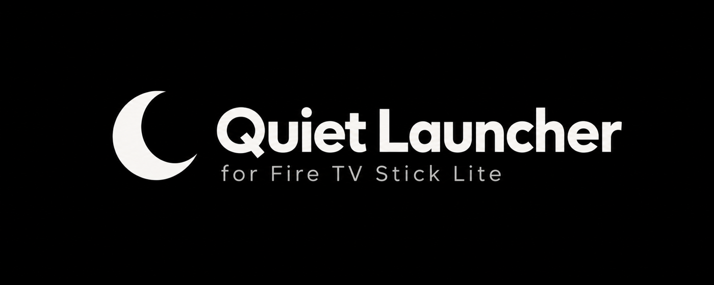
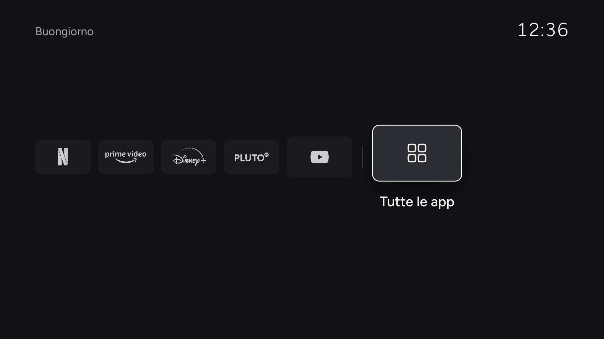
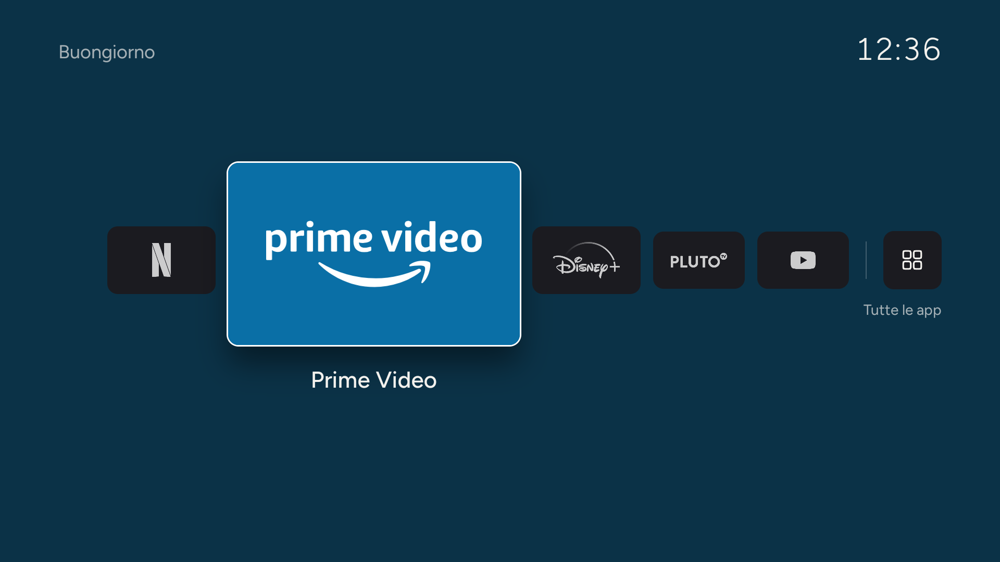
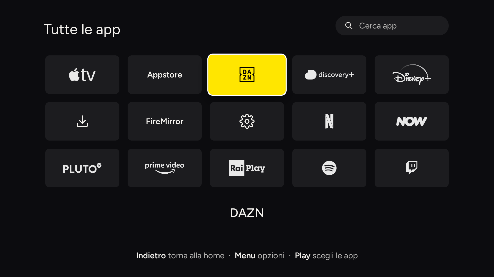
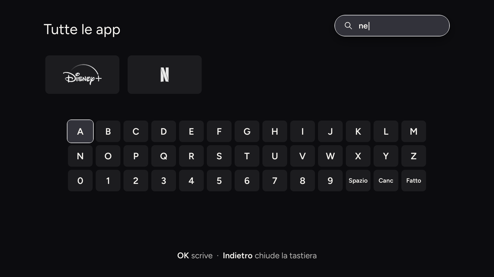
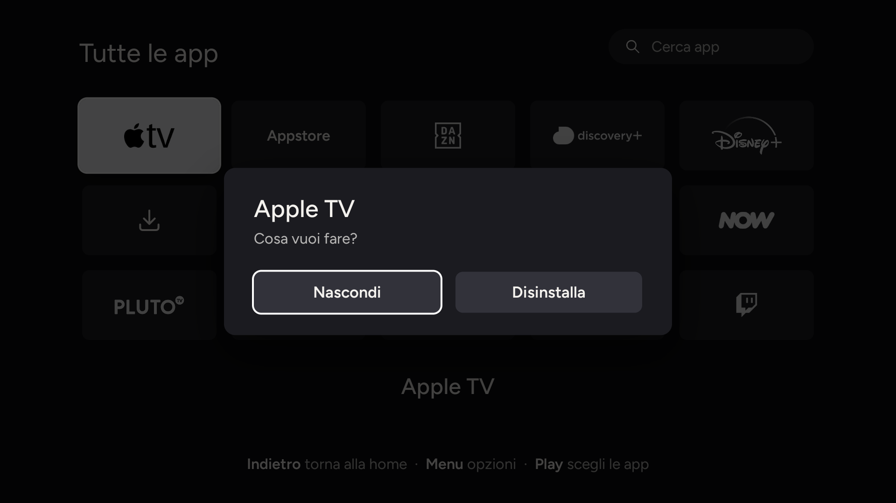

<p align="center"></p>

<p align="center">Una home minimale per Amazon Fire TV Stick: le tue app, un saluto e l'ora.<br>Niente consigliati, niente pubblicità, niente anteprime video.</p>

<p align="center"><a href="README.md">English</a></p>

<p align="center">
  
  
</p>
<p align="center">
  
  
  
</p>

## Da leggere prima

**Provata solo su due dispositivi:**

- Fire TV Stick Lite (nome in codice `sheldon`), Fire OS 7.7.1.7 (Android 9): il dispositivo per cui è nata.
- Fire TV Stick 4K, 1ª generazione (`AFTMM`), Fire OS 6.7.1.1 (Android 7.1.2): vedi [Fire OS 6](#fire-os-6-fire-tv-stick-4k-e-simili).

Non è mai stata provata su altri modelli o versioni del Fire TV e altrove potrebbe comportarsi diversamente o non funzionare. Usala a tuo rischio.

Questi Stick sono molto chiusi (bootloader bloccato, niente root, pacchetti Amazon protetti), quindi il launcher aggira il sistema invece di sostituirlo:

- **Non si può impostare un launcher di terze parti come home predefinita.** Fire OS ignora il meccanismo normale di Android.
- **Premendo Home si vede la home di Amazon per circa 5 secondi** prima che Quiet Launcher la sostituisca. Su Fire OS 7 un piccolo servizio di accessibilità (`HomeGuard`) si accorge che compare la home di Amazon e riporta in primo piano Quiet Launcher; su Fire OS 6 lo fa un servizio in background (`HomeWatch`). Questo ritardo è un limite noto di questi firmware, non un difetto che si può eliminare.
- **Le app si aprono veloci quanto sono veloci da sole** (circa un secondo a freddo su questo Stick, che ha meno di 1 GB di RAM). Il launcher non le rende più rapide.
- Le app di sistema Amazon non si possono disinstallare da qui; si possono solo nascondere dalla griglia.
- **Nella schermata *Applicazioni e giochi* di Amazon, Quiet Launcher compare con una tessera Android generica invece del suo banner.** Il banner si carica correttamente nell'app; Fire OS semplicemente non lo usa lì. È solo estetico e non abbiamo trovato una soluzione.

Se la provi su un altro modello, apri una issue e racconta cosa succede.

## Cosa fa

- **Home a fila.** L'app selezionata è grande al centro, le altre piccole e tenui; il sesto riquadro apre **Tutte le app**.
- **Scegli le tue 5 app** al primo avvio, e di nuovo quando vuoi con **Play/Pausa**.
- **Ultima app usata**: quando torni alla home è già selezionata.
- **Cerca** tra le tue app con la barra in alto e la tastiera su schermo.
- **Nascondi le app** che non usi (**Menu** → *Nascondi*) e le ritrovi nel riquadro *Mostra app nascoste*. Dallo stesso menu si possono anche disinstallare quelle non di sistema.
- **Suggerimenti dei tasti**: una riga in basso dice sempre quale tasto fa cosa nella schermata in cui sei.
- **Pausa del tasto Home**: premi **Menu** sul riquadro *Tutte le app* e scegli *Pausa 10 min*. Si apre subito la home di Amazon e per 10 minuti Home mostra la schermata di Amazon (ad esempio per cambiare un'impostazione di sistema), poi Quiet Launcher riprende da solo il suo posto. *Riattiva ora* chiude la pausa prima. Durante la pausa la home mostra "Home Amazon permessa · ancora N min".
- **Scorrimento circolare**: premendo destra sull'ultimo riquadro si torna al primo.
- **Colore del brand** sull'app evidenziata.
- **Segue la lingua di sistema** (inglese e italiano inclusi; per aggiungerne una basta un `res/values-xx/strings.xml`) e il formato 12/24 ore.
- **Screensaver** leggero dopo 5 minuti di inattività.
- Un'unica `View` che disegna su `Canvas`: niente WebView, circa 220 KB, 30–60 MB di RAM.

## Installare

1. Sul Fire TV: *Impostazioni → My Fire TV → Opzioni sviluppatore* → attiva **Debug ADB** e annota l'IP (*Rete*).
2. Compila (vedi sotto) oppure scarica l'APK dagli artifact di GitHub Actions.
3. Esegui `scripts/install.sh <ip-del-firestick>`

`install.sh` installa l'APK, attiva `HomeGuard` (Fire OS 7) e concede l'accesso ai dati di utilizzo per `HomeWatch` (Fire OS 6). Per tornare alla home di Amazon:

```sh
adb -s <ip>:5555 shell settings delete secure enabled_accessibility_services
adb -s <ip>:5555 shell appops set app.quiet.launcher GET_USAGE_STATS default
```

## Fire OS 6 (Fire TV Stick 4K e simili)

Provata su un Fire TV Stick 4K (`AFTMM`) con Fire OS 6.7.1.1 (Android 7.1.2). Cosa cambia lì:

- **I servizi di accessibilità di terze parti sono bloccati.** L'impostazione che scrive `install.sh` viene cancellata subito, quindi `HomeGuard` non parte mai.
- **Al suo posto c'è `HomeWatch`**: un piccolo servizio in primo piano legge gli eventi d'uso e, quando la home di Amazon torna in primo piano, riporta Quiet Launcher. Serve l'accesso ai dati di utilizzo, che concede `install.sh` (`appops set app.quiet.launcher GET_USAGE_STATS allow`); senza, `HomeWatch` non fa nulla. Dove `HomeGuard` è attivo, `HomeWatch` resta spento.
- **Home mostra comunque la home di Amazon per circa 5 secondi.** Dopo Home, Android trattiene per 5 s gli avvii di activity delle app (protezione "app switch"). Passare dall'AlarmManager non aiuta: su Android 7 gli allarmi vengono spostati almeno 5 s avanti.
- **Quiet Launcher si apre da solo all'accensione**, circa 35 s dopo, una sola volta per avvio, così non ti toglie mai da un'app aperta nel frattempo. Fire OS consegna `BOOT_COMPLETED` alle app una alla volta (oltre 2 minuti), quindi il receiver prende anche il precedente `LOCKED_BOOT_COMPLETED`, con priorità alta.
- **Corretto un crash all'avvio.** `Paint.setFontVariationSettings` esiste solo da API 26; sotto, i pesi da 600 in su usano il grassetto simulato.

Strade provate e chiuse su Fire OS 6.7: `ACTION_CLOSE_SYSTEM_DIALOGS` (motivo `homekey`) richiede `com.amazon.permission.ENABLE_KEYGUARD_FLAGS`, un permesso di firma; `amazon.intent.action.HOME_PRESSED` arriva solo ai pacchetti Amazon; `getRunningTasks()` nasconde il task della home.

## Compilare

Servono JDK 17+, Android SDK con `platforms;android-28` e `build-tools;34.0.0`, e `zip`. Se hai solo una piattaforma più recente, imposta `PLATFORM=android-35` (il target resta 28).

```sh
export JAVA_HOME=...   ANDROID_HOME=...
app/build.sh           # -> app/out/launcher.apk (firmato con una chiave di debug generata in app/out/)
```

`minSdk` è 21, ma il codice è compilato solo contro un SDK più recente: una chiamata al framework più nuova del dispositivo lì manda in crash l'app. Dopo la compilazione le elenchi con:

```sh
python3 tools/apicheck.py $ANDROID_HOME/platforms/android-28/data/api-versions.xml app/out/classes 21
```

Compaiono anche le chiamate già protette da `Build.VERSION.SDK_INT`: controllale a mano.

## Loghi

I loghi dei marchi **non sono inclusi**; senza di essi le app compaiono con il nome in testo. Per averli metti i tuoi SVG/PNG in `logos-src/` (nomi in `tools/make-logos.py`), esegui `python3 tools/make-logos.py` (servono Chrome e Pillow) e ricompila.

## Ottimizzare il Fire TV (facoltativo)

`scripts/optimize.sh <ip>` disattiva servizi Amazon (telemetria, anteprime, tutorial) e dimezza le animazioni. Disattiva anche gli aggiornamenti forzati di sistema, che non arriveranno più da soli. Ogni pacchetto si ripristina con `adb shell pm enable <pacchetto>`.

## Note

- Tasti gestiti: frecce, OK, Indietro, Menu, Play/Pausa. Su OK lunga non fa nulla di proposito.
- Le app note e i loro colori di brand sono in `LauncherView.java` (`KNOWN`, `PINNED`).
- Licenza MIT; vedi `NOTICE.md` per font e marchi. Non affiliata né approvata da Amazon; *Fire TV* e gli altri nomi sono marchi dei rispettivi proprietari.
