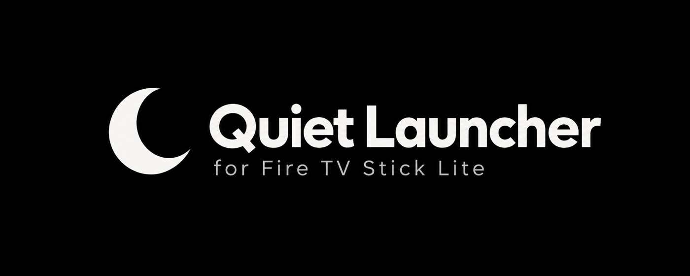
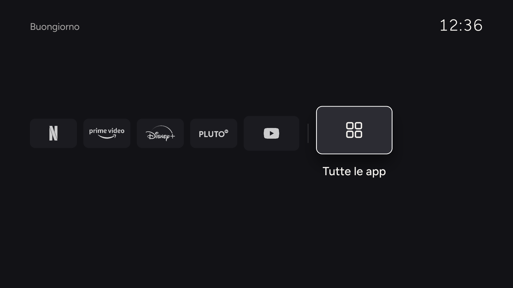
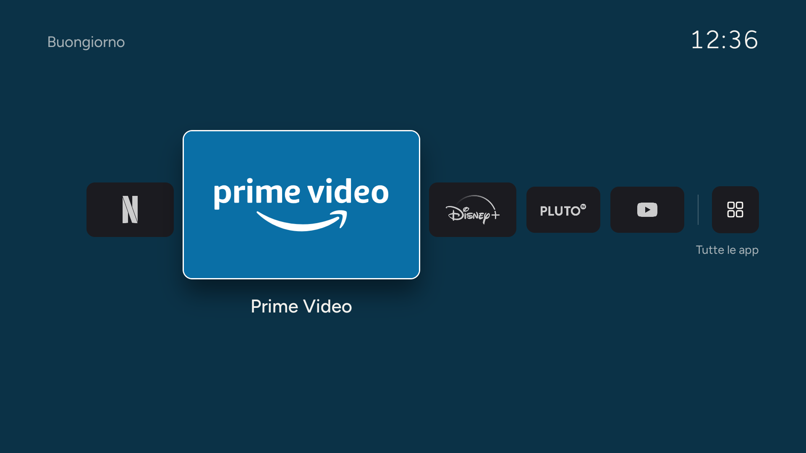
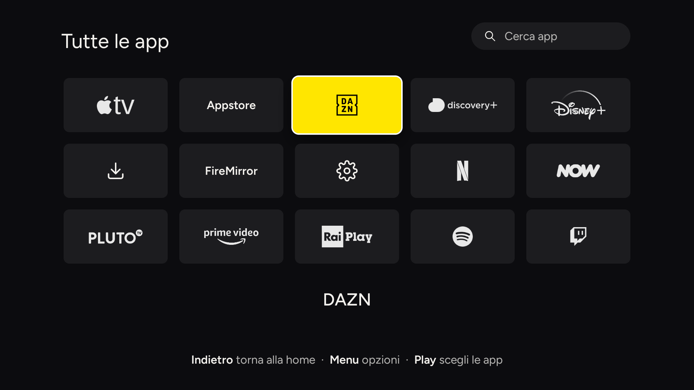
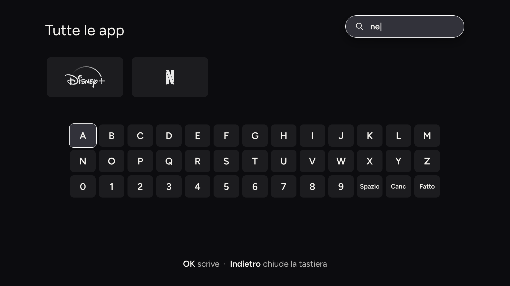
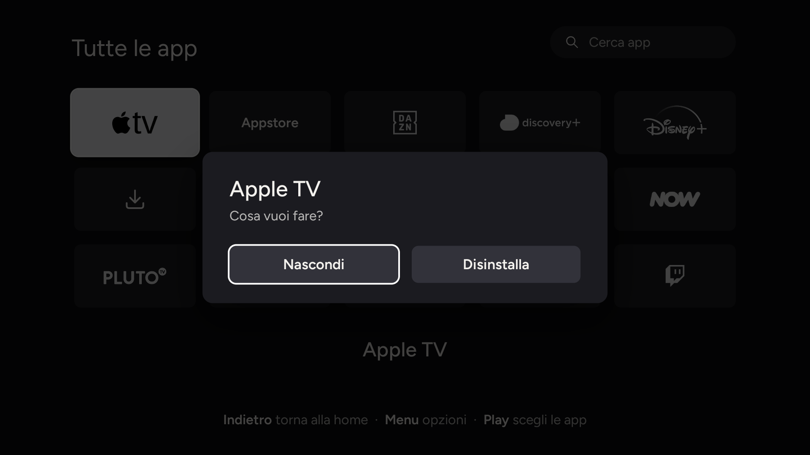

<p align="center"></p>

<p align="center">Una home minimale per Amazon Fire TV Stick: le tue app, un saluto e l'ora.<br>Niente consigliati, niente pubblicità, niente anteprime video.</p>

<p align="center"><a href="README.md">English</a></p>

<p align="center">
  
  
</p>
<p align="center">
  
  
  
</p>

## Da leggere prima

**È stata fatta per un solo dispositivo e provata solo su quello:** un Fire TV Stick Lite (nome in codice `sheldon`) con Fire OS 7.7.1.7 (Android 9). Non è mai stata provata su altri modelli o versioni del Fire TV e altrove potrebbe comportarsi diversamente o non funzionare. Usala a tuo rischio.

Quel Stick è molto chiuso (bootloader bloccato, niente root, pacchetti Amazon protetti), quindi il launcher aggira il sistema invece di sostituirlo:

- **Non si può impostare un launcher di terze parti come home predefinita.** Fire OS ignora il meccanismo normale di Android.
- **Premendo Home si vede la home di Amazon per circa 5 secondi** prima che Quiet Launcher la sostituisca. Un piccolo servizio di accessibilità (`HomeGuard`) si accorge che compare la home di Amazon e riporta in primo piano Quiet Launcher. Questo ritardo è un limite noto di questo firmware, non un difetto che si può eliminare.
- **Le app si aprono veloci quanto sono veloci da sole** (circa un secondo a freddo su questo Stick, che ha meno di 1 GB di RAM). Il launcher non le rende più rapide.
- Le app di sistema Amazon non si possono disinstallare da qui; si possono solo nascondere dalla griglia.

Se la provi su un altro modello, apri una issue e racconta cosa succede.

## Cosa fa

- **Home a fila.** L'app selezionata è grande al centro, le altre piccole e tenui; il sesto riquadro apre **Tutte le app**.
- **Scegli le tue 5 app** al primo avvio, e di nuovo quando vuoi con **Play/Pausa**.
- **Ultima app usata**: quando torni alla home è già selezionata.
- **Cerca** tra le tue app con la barra in alto e la tastiera su schermo.
- **Nascondi le app** che non usi (**Menu** → *Nascondi*) e le ritrovi nel riquadro *Mostra app nascoste*. Dallo stesso menu si possono anche disinstallare quelle non di sistema.
- **Scorrimento circolare**: premendo destra sull'ultimo riquadro si torna al primo.
- **Colore del brand** sull'app evidenziata.
- **Segue la lingua di sistema** (inglese e italiano inclusi; per aggiungerne una basta un `res/values-xx/strings.xml`) e il formato 12/24 ore.
- **Screensaver** leggero dopo 5 minuti di inattività.
- Un'unica `View` che disegna su `Canvas`: niente WebView, circa 220 KB, 30–60 MB di RAM.

## Installare

1. Sul Fire TV: *Impostazioni → My Fire TV → Opzioni sviluppatore* → attiva **Debug ADB** e annota l'IP (*Rete*).
2. Compila (vedi sotto) oppure scarica l'APK dagli artifact di GitHub Actions.
3. Esegui `scripts/install.sh <ip-del-firestick>`

`install.sh` installa l'APK e attiva `HomeGuard`. Per tornare alla home di Amazon:

```sh
adb -s <ip>:5555 shell settings delete secure enabled_accessibility_services
```

## Compilare

Servono JDK 17+, Android SDK con `platforms;android-28` e `build-tools;34.0.0`, e `zip`.

```sh
export JAVA_HOME=...   ANDROID_HOME=...
app/build.sh           # -> app/out/launcher.apk (firmato con una chiave di debug generata in app/out/)
```

## Loghi

I loghi dei marchi **non sono inclusi**; senza di essi le app compaiono con il nome in testo. Per averli metti i tuoi SVG/PNG in `logos-src/` (nomi in `tools/make-logos.py`), esegui `python3 tools/make-logos.py` (servono Chrome e Pillow) e ricompila.

## Ottimizzare il Fire TV (facoltativo)

`scripts/optimize.sh <ip>` disattiva servizi Amazon (telemetria, anteprime, tutorial) e dimezza le animazioni. Disattiva anche gli aggiornamenti forzati di sistema, che non arriveranno più da soli. Ogni pacchetto si ripristina con `adb shell pm enable <pacchetto>`.

## Note

- Tasti gestiti: frecce, OK, Indietro, Menu, Play/Pausa. Su OK lunga non fa nulla di proposito.
- Le app note e i loro colori di brand sono in `LauncherView.java` (`KNOWN`, `PINNED`).
- Licenza MIT; vedi `NOTICE.md` per font e marchi. Non affiliata né approvata da Amazon; *Fire TV* e gli altri nomi sono marchi dei rispettivi proprietari.
