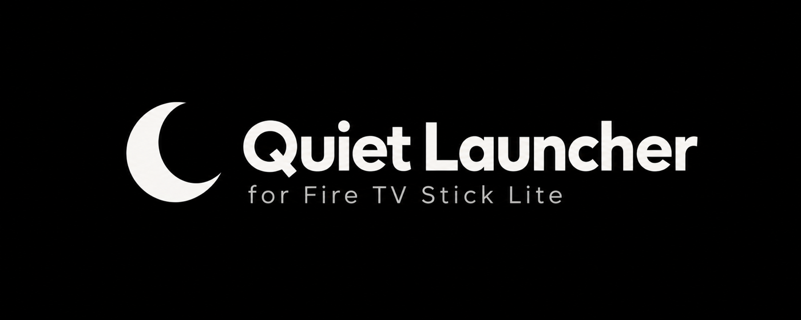
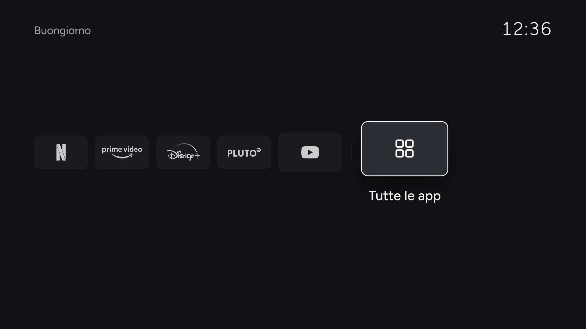
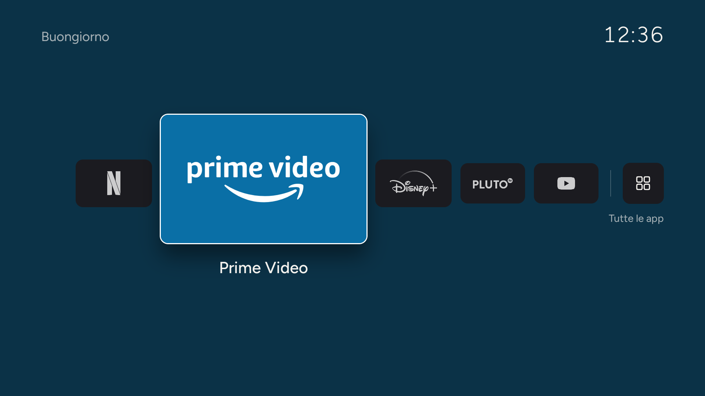
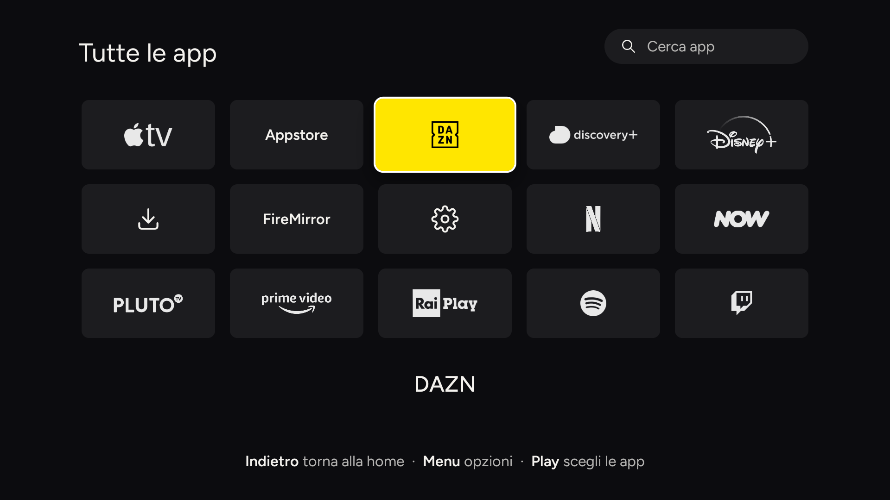
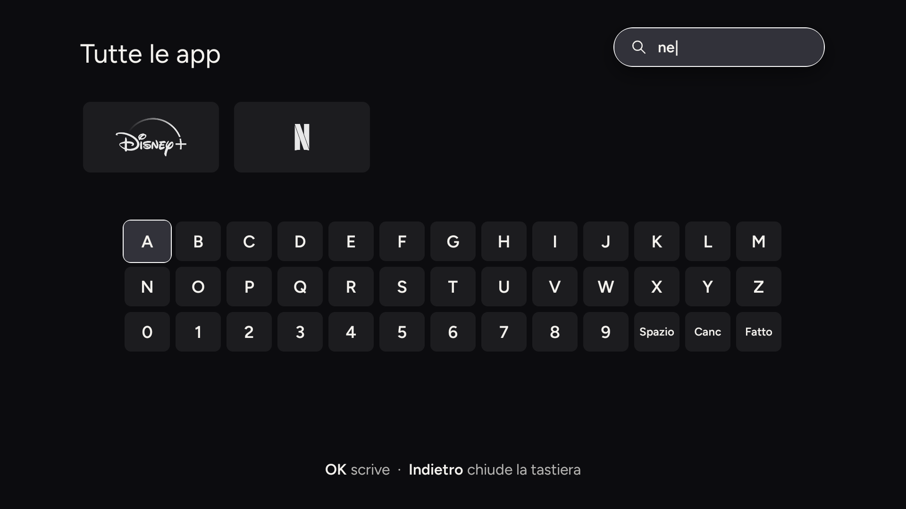
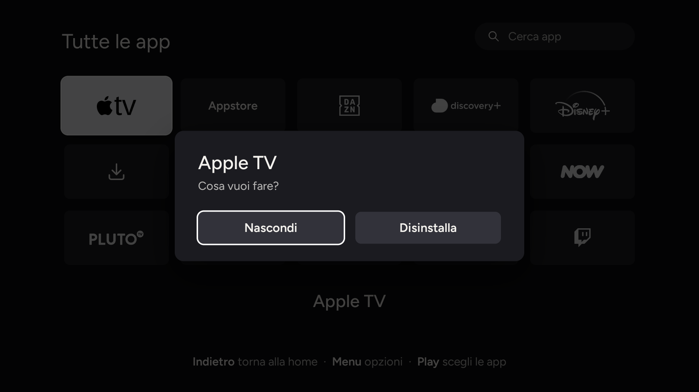

<p align="center"></p>

<p align="center">A minimal home screen for the Amazon Fire TV Stick: your apps, a greeting and the time.<br>No recommendations, no ads, no video previews.</p>

<p align="center"><a href="README.it.md">Italiano</a></p>

<p align="center">
  
  
</p>
<p align="center">
  
  
  
</p>

## Read this first

**Tested on two devices only:**

- Fire TV Stick Lite (codename `sheldon`), Fire OS 7.7.1.7 (Android 9): the device it was built for.
- Fire TV Stick 4K, 1st gen (`AFTMM`), Fire OS 6.7.1.1 (Android 7.1.2): see [Fire OS 6](#fire-os-6-fire-tv-stick-4k-and-similar).

It has not been tried on any other Fire TV model or firmware, and it may behave differently, or not work, elsewhere. Use it at your own risk.

These Sticks are heavily locked down (locked bootloader, no root, Amazon's own packages protected), so the launcher works around the system instead of replacing it:

- **You cannot set a third-party launcher as the default home.** Fire OS ignores the normal Android mechanism.
- **Pressing Home shows Amazon's home for about 5 seconds** before Quiet Launcher takes over. On Fire OS 7 a small accessibility service (`HomeGuard`) notices Amazon's home appear and brings Quiet Launcher back; on Fire OS 6 a background service (`HomeWatch`) does it. That delay is a known limit, not a bug that can be tuned away on these firmwares.
- **Opening an app is as fast as the app itself** (about a second cold on this Stick, which has under 1 GB of RAM). The launcher does not speed apps up.
- Amazon's system apps cannot be uninstalled from here; you can only hide them from the grid.
- **In Amazon's own *Apps & Games* screen Quiet Launcher shows a generic Android tile instead of its banner.** The banner loads fine inside the app; Fire OS just doesn't use it there. Purely cosmetic, and we could not find a fix.

If you try it on another model, please open an issue with what you saw.

## What it does

- **Row home.** The selected app is large in the centre, the others small and muted; the sixth tile opens **All apps**.
- **Pick your 5 apps** on first launch, and again any time with **Play/Pause**.
- **Last used app** is selected when you come back to the home.
- **Search** your apps with the bar at the top and an on-screen keyboard.
- **Hide apps** you never use (**Menu** → *Hide*) and bring them back from the *Show hidden apps* tile. Non-system apps can also be uninstalled from the same menu.
- **On-screen key hints**: a line at the bottom always tells you which button does what on the current screen.
- **Pause the Home takeover**: press **Menu** on the *All apps* tile and choose *Pause 10 min*. Amazon's home opens right away, and for 10 minutes the Home button shows Amazon's own screen (to change a system setting, say), then Quiet Launcher takes over again by itself. *Turn on now* ends the pause early. While paused, the home screen shows "Amazon's home allowed · N min left".
- **Wraps around**: pressing right on the last tile goes back to the first.
- **Brand colour** on the highlighted app.
- **Follows the system language** (English and Italian included; add another with a `res/values-xx/strings.xml`), and the 12/24 h clock setting.
- **Light screensaver** after 5 minutes idle.
- A single custom `View` drawing on a `Canvas`: no WebView, about 220 KB, roughly 30–60 MB of RAM.

## Install

1. On the Fire TV: *Settings → My Fire TV → Developer options* → turn on **ADB debugging**, and note the IP address (*Network*).
2. Build it (below) or take the APK from the GitHub Actions artifact.
3. Run `scripts/install.sh <fire-tv-ip>`

`install.sh` installs the APK, enables `HomeGuard` (Fire OS 7) and grants usage access for `HomeWatch` (Fire OS 6). To go back to Amazon's home:

```sh
adb -s <ip>:5555 shell settings delete secure enabled_accessibility_services
adb -s <ip>:5555 shell appops set app.quiet.launcher GET_USAGE_STATS default
```

## Fire OS 6 (Fire TV Stick 4K and similar)

Tested on a Fire TV Stick 4K (`AFTMM`) with Fire OS 6.7.1.1 (Android 7.1.2). What is different there:

- **Third-party accessibility services are blocked.** The setting `install.sh` writes is wiped at once, so `HomeGuard` never runs.
- **`HomeWatch` takes its place**: a small foreground service reads usage events and, when Amazon's home screen comes to the front, brings Quiet Launcher back. It needs usage access, which `install.sh` grants (`appops set app.quiet.launcher GET_USAGE_STATS allow`); without it, `HomeWatch` does nothing. Where `HomeGuard` is active, `HomeWatch` stays off.
- **Home still shows Amazon's home for about 5 seconds.** After Home, Android holds activity starts from apps for 5 s ("app switch" protection). Sending the start through an alarm does not help: on Android 7, alarms are pushed at least 5 s into the future.
- **Quiet Launcher opens by itself at boot**, about 35 s after power on, once per boot, so it never pulls you out of an app you opened in the meantime. Fire OS hands `BOOT_COMPLETED` to apps one at a time (it took over 2 minutes), so the receiver also takes the earlier `LOCKED_BOOT_COMPLETED`, with a high priority.
- **Crash at start fixed.** `Paint.setFontVariationSettings` only exists from API 26; below that, weights of 600 and up use fake bold.

Paths tried that are closed on Fire OS 6.7: `ACTION_CLOSE_SYSTEM_DIALOGS` (reason `homekey`) needs `com.amazon.permission.ENABLE_KEYGUARD_FLAGS`, a signature permission; `amazon.intent.action.HOME_PRESSED` is sent to Amazon packages only; `getRunningTasks()` hides the home task.

## Build

Needs JDK 17+, the Android SDK with `platforms;android-28` and `build-tools;34.0.0`, and `zip`. With a newer platform only, set `PLATFORM=android-35` (the app still targets 28).

```sh
export JAVA_HOME=...   ANDROID_HOME=...
app/build.sh           # -> app/out/launcher.apk (signed with a debug key generated in app/out/)
```

`minSdk` is 21, but the code is only compiled against a newer SDK, so a framework call newer than the device crashes the app there. After a build, list them with:

```sh
python3 tools/apicheck.py $ANDROID_HOME/platforms/android-28/data/api-versions.xml app/out/classes 21
```

Calls already guarded by `Build.VERSION.SDK_INT` show up too; check them by hand.

## Logos

Brand logos are **not included**; without them apps show their name as text. To get them, put your own SVG/PNG files in `logos-src/` (names in `tools/make-logos.py`), run `python3 tools/make-logos.py` (needs Chrome and Pillow), then rebuild.

## Optimise the Fire TV (optional)

`scripts/optimize.sh <ip>` disables Amazon services (telemetry, previews, tutorials) and halves animation durations. It also disables forced system updates, so they will stop arriving on their own. Any package can be restored with `adb shell pm enable <package>`.

## Notes

- Keys handled: D-pad, OK, Back, Menu, Play/Pause. A long press on OK does nothing, on purpose.
- Known apps and their brand colours are in `LauncherView.java` (`KNOWN`, `PINNED`).
- MIT licence. See `NOTICE.md` for the font and trademarks. Not affiliated with or endorsed by Amazon; *Fire TV* and the other names are trademarks of their owners.
